**English** | [简体中文](README.md)

<picture>
  <source media="(max-width: 640px) and (prefers-color-scheme: dark)" srcset="assets/presentation/hero-mobile-dark.svg">
  <source media="(max-width: 640px)" srcset="assets/presentation/hero-mobile-light.svg">
  <source media="(prefers-color-scheme: dark)" srcset="assets/presentation/hero-dark.svg">
  
</picture>

**Detect Chinese identifier, phone and internal-domain patterns in text, apply masking or blocking rules, and optionally record an audit.**

`v0.10.0` · `Python 3.12+` · [Apache-2.0](LICENSE)

[Website](https://redactgate.lei6393.com) · [Demo record](docs/demo-results.json)

## Why use it

Code and prose can contain fields that should not be sent unchanged. RedactGate detects supported patterns on explicitly routed text or gateway paths, returns hit locations, and masks or blocks by policy. Its rules do not guarantee complete data-loss prevention or compliance.

## Architecture

<picture>
  <source media="(max-width: 640px) and (prefers-color-scheme: dark)" srcset="assets/presentation/architecture-mobile-dark.svg">
  <source media="(max-width: 640px)" srcset="assets/presentation/architecture-mobile-light.svg">
  <source media="(prefers-color-scheme: dark)" srcset="assets/presentation/architecture-dark.svg">
  
</picture>

Detectors recognize candidates and apply relevant checks, rules merges defaults with overrides, and redactor rewrites matched spans. mask/proxy consumes the result and enforces block. Audit records masked previews and event metadata. The JSON-body path handles string values, and response forwarding supports streaming.

Identity, bank-card and unified-credit identifiers have checksum algorithms; phones and domains use patterns, so not every hit is checksum-validated. See [default.yaml](rules/default.yaml) and [redactor.py](src/redactgate/redactor.py).

## Install

Requires Python 3.12+. The demo uses deliberately synthetic text. Exit 1 from scan or block is expected when a hit is present.

```bash
git clone https://github.com/SuperMarioYL/redactgate.git
cd redactgate
python3 -m venv .venv
source .venv/bin/activate
python -m pip install -e .
```

## Quickstart

The real scan, label masker and block filter run locally; the final step emits no stdout. No proxy, model request or legal-compliance verification is performed.

```bash
python -m redactgate.cli scan examples/presentation-input.txt --json
python -m redactgate.cli mask --style label < examples/presentation-input.txt
python -m redactgate.cli mask --rules examples/presentation-block.yaml < examples/presentation-input.txt
```

The complete input is [presentation-input.txt](examples/presentation-input.txt), with a [one-line block override](examples/presentation-block.yaml) and a [command script](examples/presentation_demo.sh).

## Usage

scan FILE --json emits locations, types and rule scores, exiting 1 on hits. mask reads stdin; --style selects masking, --report sends a summary to stderr, and --audit enables JSONL. Default partial masking retains prefix/suffix characters and is not full anonymization.

## Recorded demo

<picture>
  <source media="(max-width: 640px) and (prefers-color-scheme: dark)" srcset="assets/presentation/process-mobile-dark.svg">
  <source media="(max-width: 640px)" srcset="assets/presentation/process-mobile-light.svg">
  <source media="(prefers-color-scheme: dark)" srcset="assets/presentation/process-dark.svg">
  
</picture>

### Locate synthetic fields

scan returns hit locations; exit 1 indicates detected fields.

```text
$ python -m redactgate.cli scan examples/presentation-input.txt --json
{"file": "examples/presentation-input.txt", "type": "id_card", "line": 2, "col": 4, "checksum_valid": true, "confidence": 0.99}
{"file": "examples/presentation-input.txt", "type": "phone", "line": 3, "col": 7, "checksum_valid": false, "confidence": 0.8}
{"file": "examples/presentation-input.txt", "type": "intranet_domain", "line": 4, "col": 10, "checksum_valid": false, "confidence": 0.85}
```

### Replace with labels

Apply label style to recognized spans.

```text
$ python -m redactgate.cli mask --style label < examples/presentation-input.txt
Synthetic fixture
id=[身份证-已脱敏]
phone=[手机号-已脱敏]
intranet=[内网域名-已脱敏]
order=110101199003078500
```

### Block output

A block-policy hit exits 1 with empty stdout.

```text
$ python -m redactgate.cli mask --rules examples/presentation-block.yaml < examples/presentation-input.txt

```

## Capabilities and integration

<picture>
  <source media="(max-width: 640px) and (prefers-color-scheme: dark)" srcset="assets/presentation/integrations-mobile-dark.svg">
  <source media="(max-width: 640px)" srcset="assets/presentation/integrations-mobile-light.svg">
  <source media="(prefers-color-scheme: dark)" srcset="assets/presentation/integrations-dark.svg">
  
</picture>

Only routed input is processed. Unrouted traffic, unsupported formats and missed patterns are not automatically protected. Gateway integration and model-protocol compatibility require separate validation beyond stdin results.


## Configuration

default_policy selects mask/block, min_confidence is a rule threshold, masking controls style and retained length, and detectors is per type; allowlist and custom_patterns append. proxy --upstream requires explicitly routing the client base URL. Ordinary HTTPS_PROXY CONNECT does not provide TLS-decrypting redaction.

## Roadmap and scope

Local scan/mask, explicit HTTP gateway, JSON handling, blocking and audit are implemented. Central policy, team SSO, more regional formats and compliance-report services remain future work, not live plans.

- Supported patterns and checks are limited and cannot guarantee detection of all sensitive data.
- Rule confidence is a fixed score, not a calibrated probability.
- Local detection is not legal-compliance or end-to-end data-loss-prevention proof.

[Terminal recording](assets/demo.gif) · [Recording script](docs/demo.tape)

## License

[Apache-2.0](LICENSE)
