[English](README.en.md) | **简体中文**

<picture>
  <source media="(max-width: 640px) and (prefers-color-scheme: dark)" srcset="assets/presentation/hero-mobile-dark.svg">
  <source media="(max-width: 640px)" srcset="assets/presentation/hero-mobile-light.svg">
  <source media="(prefers-color-scheme: dark)" srcset="assets/presentation/hero-dark.svg">
  
</picture>

**识别文本中的中国标识符、手机号和内网域名模式，按规则掩码或阻断，并可记录审计。**

`v0.10.0` · `Python 3.12+` · [Apache-2.0](LICENSE)

[Website](https://redactgate.lei6393.com) · [Demo record](docs/demo-results.json)

## 为什么使用

代码和说明文字里可能混有不应直接发送的字段。RedactGate 在显式接入的文本或网关路径上识别支持的模式，返回命中位置，并根据规则替换或阻断。规则检测范围有限，不是数据不外流或合规状态的全面保证。

## 架构

<picture>
  <source media="(max-width: 640px) and (prefers-color-scheme: dark)" srcset="assets/presentation/architecture-mobile-dark.svg">
  <source media="(max-width: 640px)" srcset="assets/presentation/architecture-mobile-light.svg">
  <source media="(prefers-color-scheme: dark)" srcset="assets/presentation/architecture-dark.svg">
  
</picture>

detectors 识别候选并执行适用校验，rules 合并内置与用户配置，redactor 处理命中区间，mask/proxy 消费结果并执行 block。audit 保存掩码预览与事件元数据。JSON 请求体路径会处理字符串值，响应转发支持流式读取。

身份证、银行卡和统一社会信用代码分别有校验算法；手机号与域名按模式识别，并非全部命中都有校验位。规则与部分掩码行为见 [default.yaml](rules/default.yaml) 和 [redactor.py](src/redactgate/redactor.py)。

## 安装

需要 Python 3.12+。示例使用刻意构造的测试文本，scan 与 block 命中时退出 1 是预期行为。

```bash
git clone https://github.com/SuperMarioYL/redactgate.git
cd redactgate
python3 -m venv .venv
source .venv/bin/activate
python -m pip install -e .
```

## 快速开始

实际运行 scan、label 掩码和 block 过滤器；最后一步没有 stdout。没有启动代理、发送模型请求或验证法律合规。

```bash
python -m redactgate.cli scan examples/presentation-input.txt --json
python -m redactgate.cli mask --style label < examples/presentation-input.txt
python -m redactgate.cli mask --rules examples/presentation-block.yaml < examples/presentation-input.txt
```

完整输入为 [presentation-input.txt](examples/presentation-input.txt)，block 覆盖只有 [一行 YAML](examples/presentation-block.yaml)，命令见 [脚本](examples/presentation_demo.sh)。

## 使用

scan FILE --json 输出位置、类型和规则分值；有命中退出 1。mask 从 stdin 读取，--style 选择掩码形式，--report 将统计写入 stderr，--audit 可记录 JSONL。默认 partial 保留头尾字符，不能当作完整匿名化。

## 实际 Demo

<picture>
  <source media="(max-width: 640px) and (prefers-color-scheme: dark)" srcset="assets/presentation/process-mobile-dark.svg">
  <source media="(max-width: 640px)" srcset="assets/presentation/process-mobile-light.svg">
  <source media="(prefers-color-scheme: dark)" srcset="assets/presentation/process-dark.svg">
  
</picture>

### 定位合成字段

scan 返回命中位置，退出 1 表示发现字段。

```text
$ python -m redactgate.cli scan examples/presentation-input.txt --json
{"file": "examples/presentation-input.txt", "type": "id_card", "line": 2, "col": 4, "checksum_valid": true, "confidence": 0.99}
{"file": "examples/presentation-input.txt", "type": "phone", "line": 3, "col": 7, "checksum_valid": false, "confidence": 0.8}
{"file": "examples/presentation-input.txt", "type": "intranet_domain", "line": 4, "col": 10, "checksum_valid": false, "confidence": 0.85}
```

### 替换为标签

仅对识别区间应用 label 样式。

```text
$ python -m redactgate.cli mask --style label < examples/presentation-input.txt
Synthetic fixture
id=[身份证-已脱敏]
phone=[手机号-已脱敏]
intranet=[内网域名-已脱敏]
order=110101199003078500
```

### 阻断输出

block 策略命中后退出 1，stdout 为空。

```text
$ python -m redactgate.cli mask --rules examples/presentation-block.yaml < examples/presentation-input.txt

```

## 能力与接入

<picture>
  <source media="(max-width: 640px) and (prefers-color-scheme: dark)" srcset="assets/presentation/integrations-mobile-dark.svg">
  <source media="(max-width: 640px)" srcset="assets/presentation/integrations-mobile-light.svg">
  <source media="(prefers-color-scheme: dark)" srcset="assets/presentation/integrations-dark.svg">
  
</picture>

只处理经过本工具的输入；未路由流量、未支持格式、漏报模式不会自动受保护。网关接入与模型协议兼容性需要单独验证，不能仅凭 stdin 结果宣称全链路保护。


## 配置

default_policy 可选 mask/block，min_confidence 为规则阈值，masking 控制样式与保留长度，detectors 按类型配置，allowlist 和 custom_patterns 追加。proxy --upstream 需要客户端显式设置网关 base URL；普通 HTTPS_PROXY CONNECT 不提供 TLS 解密脱敏。

## 路线图与范围

当前已有本地 scan/mask、显式 HTTP 网关、JSON 处理、block 和审计。集中策略管理、团队 SSO、更多地区格式与合规报告服务仍是后续方向，不作为已上线套餐。

- 支持的模式与校验有限，不能保证发现全部敏感数据。
- 规则 confidence 是静态分值，不是已校准概率。
- 本地检测不等于法律合规或全链路防泄漏证明。

[Terminal recording](assets/demo.gif) · [Recording script](docs/demo.tape)

## 许可证

[Apache-2.0](LICENSE)
